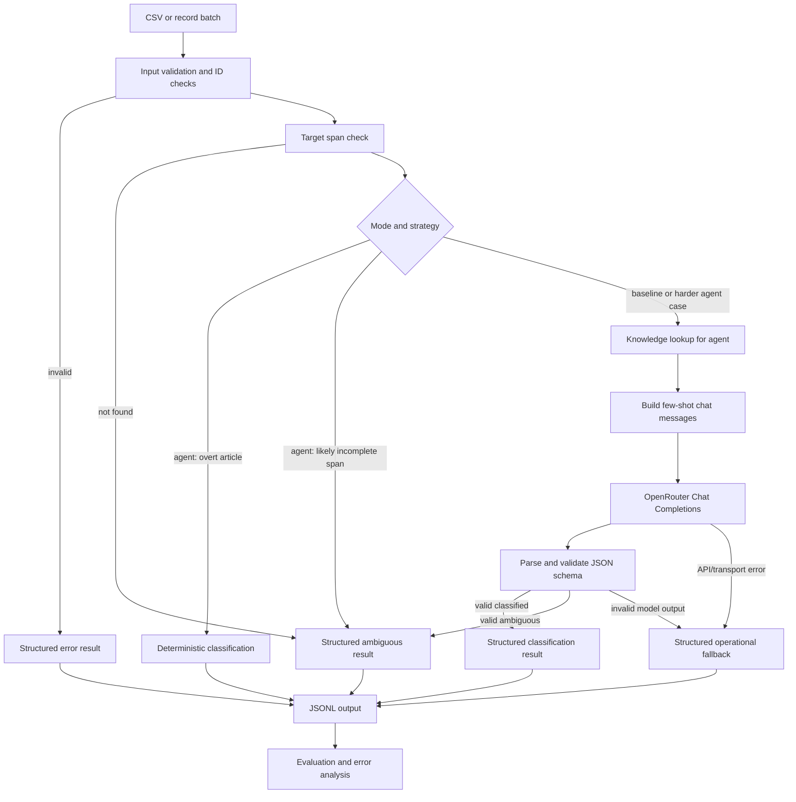

# Design Notes: English Article Analysis Agent

## 1. Goal and non-goals

The goal is to classify article realization for one supplied target noun phrase in an English sentence, with an explicit path for uncertain cases. The project demonstrates a small, testable LLM application: data contracts, deterministic routing, local retrieval, prompt construction, API transport, strict output validation, robust batch behavior, and evaluation.

Non-goals for the MVP are full syntactic parsing, general-purpose autonomous planning, exhaustive coverage of English determiner grammar, multilingual support, a hosted service, persistent storage, or provider-native tool calling.

## 2. Requirements

### Functional requirements

1. Accept records with `id`, `text`, `target_phrase`, and optional `context`.
2. Validate non-empty required strings, context type, and unique identifiers within a batch.
3. Classify the target noun phrase as `definite`, `indefinite`, or `zero`; represent uncertainty as `article: null, status: ambiguous`.
4. Never infer zero article merely from absence of `a`, `an`, or `the`.
5. Perform a narrow deterministic fast path for a verified target phrase beginning with overt `a`, `an`, or `the`.
6. Retrieve curated, locally stored rules from `knowledge_base.json` for harder cases.
7. Submit ordinary OpenRouter Chat Completions requests with few-shot examples; keep model selection configurable through environment variables.
8. Validate the model's JSON keys, types, vocabulary, and consistency before accepting a label.
9. Retry retryable HTTP 429/5xx and connection/timeout errors up to three total attempts, with a two-second delay between retryable attempts only.
10. Produce one structured result per input record and continue a batch after per-record failures.
11. Compare baseline and agent on the same held-out examples and calculate accuracy, per-class scores, macro-F1, coverage, ambiguity, fallback, operational failure, and by-category metrics.
12. Test transport behavior using mocks; tests must not require an API key or network.

### Non-functional requirements

- **Understandability:** standard-library CSV/JSON/JSONL logic and small functions, with only `requests`, `python-dotenv`, and `pytest` as direct dependencies.
- **Reproducibility:** deterministic test doubles; fixed dev/test annotation split; temperature set to zero for OpenRouter requests.
- **Reliability:** bounded retries, explicit timeouts, per-record failure capture, no credential logging, and no fabricated label when a request fails.
- **Auditability:** preserve input IDs/fields, record source, explanation/evidence, error code, and fallback status.
- **Scope discipline:** no agent framework, database, vector store, or native tool calling until an experiment establishes a specific need.

## 3. Linguistic scope and annotation assumptions

The target phrase is expected to be the full noun phrase whose article is being classified. Labels describe article form, not semantic definiteness as an abstract discourse property:

- `definite`: overt `the` begins the target NP.
- `indefinite`: overt `a` or `an` begins the target NP.
- `zero`: the target is a licensed bare NP with no overt article and no competing determiner. Common examples include bare plurals, bare mass nouns, proper names, and some conventional institutional expressions.
- `ambiguous`: the target is unlocatable/incomplete, outside the three-label scope, malformed or potentially ungrammatical, or unresolved from the provided evidence.
- `error`: an operational/input/schema failure prevents a valid result. It is not a linguistic label.

A phrase with a possessive (`my brother`), demonstrative (`this house`), quantifier (`some information`), or pronoun (`her`) is not automatically zero in this project's chosen scope. A singular count noun without a determiner (`I bought book yesterday`) is not automatically zero either. Proper-name conventions (`Paris` vs. `the Netherlands`) and institutional expressions (`go to school`, `the hospital`) require lexical/contextual care; regional and annotator variation should be recorded rather than concealed.

The deterministic logic checks whether the target text occurs as a contiguous case-insensitive span and whether it begins with an overt article. A second narrow check can abstain if a determiner immediately precedes a likely incomplete target span (for example, target `dog` in `The dog barked`). It does not do full NP parsing; it can miss more complex spans such as `dog` inside `the old dog`. The LLM plus local guidance handles such cases, and the gold set includes incomplete-span examples.

The dataset is deliberately modest. Some constructions—especially institutional readings, mass-noun ellipsis, and dialect-sensitive usage—can admit expert disagreement. Before using it for research claims, annotations should be independently reviewed and disagreement recorded.

## 4. Architecture



### Components and responsibilities

- `validate_record`: validates field presence/type/emptiness. Batch-level unique IDs are checked by `process_records`.
- `target_phrase_occurs` and `deterministic_article`: narrow lexical checks; these do not infer a zero label.
- `knowledge_lookup`: independent local tool with a stable contract: input sentence, target phrase, and parsed knowledge-base mapping; output a bounded list of matching rule dictionaries; no classification side effect.
- `build_messages`: creates baseline/agent prompts and includes target-specific few-shot examples.
- `OpenRouterClient.complete`: handles only HTTP transport, bounded retry, timeout, and API-envelope validation. It does not decide linguistic labels.
- `parse_model_output`: validates the four-key model schema and consistency rules.
- `classify_record`: orchestrates one record and converts per-record errors to a stable output shape.
- `process_records`: processes independent records in order and catches duplicate identifiers without stopping later rows.
- `eval.py`: aligns output with gold by ID and calculates metrics with documented denominators.

## 5. Strategy decision table

| Situation | Strategy | Expected outcome | Reason |
|---|---|---|---|
| Target appears and begins with overt `a`/`an` | Deterministic check in agent mode | `indefinite` | Direct evidence of article form |
| Target appears and begins with overt `the` | Deterministic check in agent mode | `definite` | Direct evidence of article form |
| Target does not occur as a contiguous span | Pre-model validation | `ambiguous`, `article=null` | The requested usage cannot be grounded in the sentence |
| A determiner immediately precedes a target that omits it | Narrow target-span check in agent mode | `ambiguous`, `article=null` | The target may be only part of a larger NP |
| Bare plural or bare mass noun with a plausible licensed construction | Local rule retrieval + LLM | `zero` if evidence suffices; otherwise abstain | Requires identifying the construction, not mere article absence |
| Proper noun or institutional phrase | Local rule retrieval + LLM/context | Label when lexical construction is supported; otherwise abstain | Article conventions and meaning vary |
| Possessive/demonstrative/quantifier or pronoun as target | LLM guidance / abstention | Usually `ambiguous` in MVP scope | These are not treated as zero article in this scope |
| Potentially malformed bare singular count NP | LLM guidance / abstention | `ambiguous` unless licensed use is clear | Missing article does not prove zero |
| HTTP 429/5xx, timeout, or connection error | Bounded retry; then fallback result | `error`, `article=null` | Operational failure is distinct from linguistic ambiguity |
| Other HTTP 4xx, malformed API envelope, invalid model JSON/schema | No retry for non-retryable failures; structured result | `error`, `article=null` | Avoid hiding client/configuration or response-contract failures |

The baseline intentionally skips rule lookup and contextual instructions, using a concise few-shot LLM prompt. The agent includes context, local rules, the overt-article fast path, and explicit instructions to abstain. Output validation and safe result formation are common infrastructure for both configurations.

## 6. Input/output contracts

### Input record

```json
{
  "id": "example-1",
  "text": "I saw a dog near the house.",
  "target_phrase": "the house",
  "context": ""
}
```

Required keys `id`, `text`, and `target_phrase` must be non-empty strings. `context` may be omitted, blank, or `null`; if supplied as another type, input validation fails. Extra input fields are ignored by classification. Batch identifiers must be unique after trimming whitespace.

### Model output schema

The model must return exactly these keys:

```json
{
  "article": "definite",
  "status": "classified",
  "explanation": "The target noun phrase begins with the overt definite article 'the'.",
  "evidence": ["Target phrase: 'the house'", "Overt article: 'the'"]
}
```

`article` must be `definite`, `indefinite`, `zero`, or JSON `null`. `status` must be `classified` or `ambiguous`. A classified result requires a label; an ambiguous result requires `article: null`. Explanation is a non-empty string and evidence is a list of non-empty strings. Additional keys are rejected.

### Final result

The final record preserves `id`, `text`, and `target_phrase`, and adds `article`, `status`, `explanation`, `evidence`, `source`, `error`, and `fallback_used`. `status=error` includes a sanitized `{code, message, retryable}` object and never claims a linguistic label. Error messages do not include authorization headers or response bodies.

## 7. Representative user scenario

A linguist supplies the sentence `I saw a dog near the house.` with target `the house`. Input validation confirms the required fields. Agent mode verifies that the target span exists and begins with `the`, so it returns `definite` through the deterministic path without an API call. If the same record targets `Dogs` in `Dogs are great`, the fast path does not infer zero. The knowledge tool retrieves bare-plural guidance and the LLM decides whether the phrase is a licensed bare NP or requires abstention. If the model returns malformed JSON, the schema parser rejects it and the batch records an operational error without stopping subsequent rows.

## 8. Reliability and failure-mode analysis

| Failure mode | Detection | Handling | Test coverage |
|---|---|---|---|
| Missing/empty required input | `validate_record` | `status=error`, code `invalid_input` | Parametrized input tests |
| Duplicate ID in one batch | `process_records` | Second occurrence becomes `status=error`; later records continue | Batch-order test |
| Target phrase not found | contiguous span check | `status=ambiguous`, no API call | Ambiguous-span test |
| Likely incomplete target preceded by determiner | narrow span check in agent mode | Abstain as ambiguous; no guessed zero | Incomplete-target test |
| Valid ambiguous model decision | model schema parser accepts null + ambiguous | Preserve `status=ambiguous` | Ambiguous LLM response test |
| Invalid model JSON, extra key, wrong type, inconsistent fields | strict parser | `status=error`, code `invalid_model_output` | Parametrized schema tests |
| HTTP 429 or 5xx | HTTP status code | Up to three attempts; two-second delay between retryable attempts | Retry tests |
| Connection error or timeout | requests exception classes | Up to three attempts; no final sleep | Transport tests |
| Non-retryable 4xx | HTTP status code | One attempt and structured error | HTTP 400 test |
| Invalid JSON or missing `choices/message/content` | API-envelope check | Structured API error, no blind retry | Envelope tests |
| API key absent | configuration check before request | Structured `missing_api_key` result; no network request | Missing-key test |
| Prediction missing from an evaluation file | ID alignment | Count as incorrect for classifiable gold and operational failure in rates | Metric test |
| Linguistic uncertainty vs infrastructure failure | distinct `ambiguous` and `error` statuses | Separate ambiguity and operational metrics | Metric test |

### Retry semantics

The API client caps attempts at three even if configured with a larger number. Retryable events are HTTP 429, HTTP 5xx, `requests` connection errors, and timeouts. It sleeps two seconds after a retryable failure only when another attempt remains. Non-retryable 4xx, malformed API envelopes, and invalid model output are not retried. The request has an explicit `(5-second connect, configured read)` timeout tuple.

## 9. Evaluation protocol

The `dev` split is for iteration. The `test` split is held out until a prompt/rule configuration is selected. The comparison command uses the exact same test IDs for both modes and writes raw predictions plus `metrics.json`. The metric artifact includes per-ID outcomes (`correct`, `incorrect_label`, `abstained_on_classifiable_gold`, `correct_abstention`, `confident_prediction_on_ambiguous_gold`, `operational_failure`, `missing_prediction`, or `invalid_prediction`) and a category-level failure summary with suggestions for the next investigation.

The test set contains clear definite/indefinite cases, generic and specific bare plurals, mass nouns, proper names with/without conventional articles, institutional expressions, contextual definite reference, multiple article types in one sentence, out-of-scope targets, and underspecified spans. Four robustness fixtures are intentionally excluded from linguistic quality metrics and instead inform mocked tests.

Denominators are always explicit:

- Accuracy and per-class P/R/F1 use only gold-classifiable examples; system abstentions/errors/missing predictions count as incorrect.
- Coverage, ambiguity rate, fallback rate, and operational-failure rate use all linguistic examples, including gold-ambiguous examples.
- Ambiguity recall uses gold-ambiguous examples.
- Category accuracy uses classifiable examples within the category; category coverage uses all examples within it.

Model-generated explanations are diagnostic only, never evidence of correctness. Actual results must come from a run using the configured API; mock-based unit test results are not reported as accuracy.

## 10. Why not a larger agent framework?

The task has one small tool, one fixed analysis request, a finite output schema, and a short recovery path. A transparent Python pipeline is easier to debug and test than adding LangChain/LangGraph, a vector store, a database, MCP, or a custom tool-calling protocol. JSON keyword retrieval is adequate until measured errors show that rule selection is weak. Standard Chat Completions avoids assuming that the chosen model supports native tool calling.

## 11. Possible evolution

- **API service:** wrap `classify_record` with FastAPI, define request/response models, add rate limiting and request IDs, and keep batch failure isolation. This is useful only if a caller needs remote access.
- **MCP-integrated agent:** expose `knowledge_lookup` as an MCP tool if an MCP-capable client needs to call the rule base independently. Keep the same schema validation and error contract around model output; do not treat MCP as a quality improvement by itself.
- **Quality improvement:** adjudicate disagreement cases, add a confusion/error table to `eval.py`, test alternate prompts/rule triggers on `dev`, then freeze the configuration before evaluating `test`.
- **Linguistic extension:** define whether targets with alternative determiners belong in a larger four-way or feature-based annotation scheme, add dialect metadata where relevant, and consider a parser only if errors show that shallow span handling is the limiting factor.
